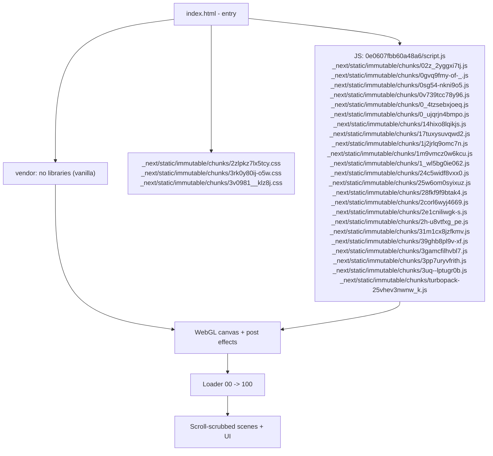
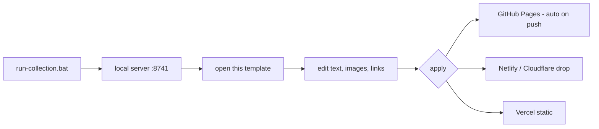

# 3D Island Voyage Illustrator — 3D Illustrator Portfolio Template

> Three.js ocean voyage portfolio with 15 local glb islands, water shader and a WANTED-poster preloader.

`creative` · `3d` · `HTML/CSS/JS`

**Live:** https://sudiptasanki.github.io/PortfolioBuilder/creative/3d-illustrator/3d-3d-island-voyage-portfolio-portfolio/index.html

---

## How it works



## Run it locally



**Quick start (this repository):**

1. Double-click `run-collection.bat` (opens all 18) or `run-preview-hub.bat` (categorized hub).
   Both auto-start the local server at http://127.0.0.1:8741.
2. Open http://127.0.0.1:8741/creative/3d-illustrator/3d-3d-island-voyage-portfolio-portfolio/index.html

**Standalone (no repo):**

```bash
cd templates/html/github-pages/creative/3d-illustrator/3d-3d-island-voyage-portfolio-portfolio
python -m http.server 8741
# open http://localhost:8741
```

Opening `index.html` directly from disk also works in most browsers — use the server if any asset looks blocked.

## Apply it

| Option | How |
|---|---|
| **This repo (auto)** | Keep the folder under `templates/html/github-pages/...` — pushing to `main` deploys it to GitHub Pages automatically and the showcase picks it up on the next catalog compile |
| **Netlify / Cloudflare** | Drag-and-drop this folder onto their dashboards — zero build step |
| **Vercel** | Import the folder as a static project (framework preset: Other) |
| **Own GitHub repo** | Push the folder, enable Pages on the branch — same file layout works |

## Files

| Path | Purpose |
|---|---|
| `index.html` | Entry page — all markup |
| `_next/static/immutable/chunks/2zlpkz7lx5tcy.css` | Styles |
| `_next/static/immutable/chunks/3rk0y80ij-o5w.css` | Styles |
| `_next/static/immutable/chunks/3v0981__klz8j.css` | Styles |
| `0e0607fbb60a48a6/script.js` | Behaviour / animation |
| `_next/static/immutable/chunks/02z_2yggxi7tj.js` | Behaviour / animation |
| `_next/static/immutable/chunks/0gvq9fmy-of-_.js` | Behaviour / animation |
| `_next/static/immutable/chunks/0sg54-nkni9o5.js` | Behaviour / animation |
| `_next/static/immutable/chunks/0v739tcc78y96.js` | Behaviour / animation |
| `_next/static/immutable/chunks/0_4tzsebxjoeq.js` | Behaviour / animation |
| `_next/static/immutable/chunks/0_ujqrjn4bmpo.js` | Behaviour / animation |
| `_next/static/immutable/chunks/14hixo8lqikjs.js` | Behaviour / animation |
| `_next/static/immutable/chunks/17tuxysuvqwd2.js` | Behaviour / animation |
| `_next/static/immutable/chunks/1j2jrlq9omc7n.js` | Behaviour / animation |
| `_next/static/immutable/chunks/1m9vmcz0w6kcu.js` | Behaviour / animation |
| `_next/static/immutable/chunks/1_wl5bg0ie062.js` | Behaviour / animation |
| `_next/static/immutable/chunks/24c5widf8vxx0.js` | Behaviour / animation |
| `_next/static/immutable/chunks/25w6om0syixuz.js` | Behaviour / animation |
| `_next/static/immutable/chunks/28fkf9f9btak4.js` | Behaviour / animation |
| `_next/static/immutable/chunks/2corl6wyj4669.js` | Behaviour / animation |
| `_next/static/immutable/chunks/2e1cniliwgk-s.js` | Behaviour / animation |
| `_next/static/immutable/chunks/2h-u8vtfxg_pe.js` | Behaviour / animation |
| `_next/static/immutable/chunks/31m1cx8jzfkmv.js` | Behaviour / animation |
| `_next/static/immutable/chunks/39ghb8pl9v-xf.js` | Behaviour / animation |
| `_next/static/immutable/chunks/3gamcfilhvbl7.js` | Behaviour / animation |
| `_next/static/immutable/chunks/3pp7uryvfrith.js` | Behaviour / animation |
| `_next/static/immutable/chunks/3uq--lptugr0b.js` | Behaviour / animation |
| `_next/static/immutable/chunks/turbopack-25vhev3nwnw_k.js` | Behaviour / animation |
| `images/books/game-changing-de.webp` | Static asset |
| `images/books/game-changing-en.webp` | Static asset |
| `images/cartridges/concept-whiteboard.webp` | Static asset |
| `images/cartridges/keynote-stage.webp` | Static asset |
| `images/cartridges/workshop-v2.webp` | Static asset |
| `images/wanted-elena.webp` | Static asset |
| `template.json` | Catalog metadata (id, live URL, deployment shard) |

## Make it yours

1. Search `index.html` for the persona name and replace it (plus emails and social links).
2. Swap images in `assets/photos/` — keep the same filenames, or update the references.
3. Project entries live in the JS data block (search for `title:`) or directly in the HTML.

---

Credits: Three.js (MIT) and GSAP (GreenSock standard license) vendored where used · photography stored locally (Unsplash License) · part of the [Portfolio Builder](https://github.com/SudiptaSanki/PortfolioBuilder) open-source collection · MIT.
