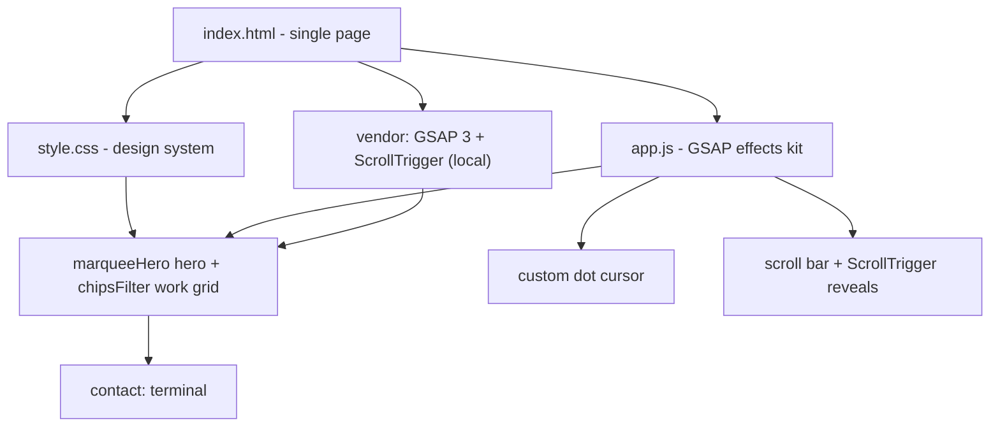
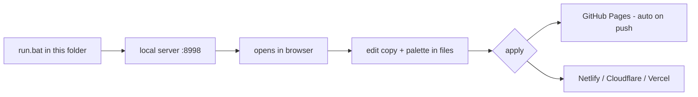

# Perfume Store · warm — Perfume Store Owner Portfolio Template (Genre Lab)

> undefined

`retail` · `marqueeHero` hero · `chipsFilter` work grid · `dot` cursor · `warm` scheme

**Live:** https://sudiptasanki.github.io/PortfolioBuilder/retail/perfume-store/perfume-store-warm/index.html

---

## How it works



All effects run on **GSAP 3 + ScrollTrigger** (vendored locally in `vendor/`) — no npm install, no CDN, works offline.

## Run it locally



Or simply double-click `run.bat` in this folder — it serves this exact folder and opens the site (works even if you copy this folder anywhere else, e.g. `D:\My Projects\3d Template\25\`).

Standalone without Python:

```bash
cd templates/html/github-pages/retail/perfume-store/perfume-store-warm
python -m http.server 8998
```

## Apply it

| Option | How |
|---|---|
| **This repo (auto)** | Keep under `templates/html/github-pages/...` — push to `main` deploys to GitHub Pages automatically |
| **Netlify / Cloudflare** | Drag-and-drop this folder — zero build step |
| **Vercel** | Static import, framework preset: Other |
| **Own repo** | Copy folder → push → enable Pages |

## Files

| Path | Purpose |
|---|---|
| `index.html` | Single-page markup |
| `style.css` | Full design system (palette in `:root`) |
| `app.js` | Effects kit — GSAP timelines, ScrollTrigger, interactions |
| `vendor/` | GSAP 3 + ScrollTrigger (local, no CDN) |
| `assets/photos/` | 4 local images — about + work cards |
| `run.bat` | One-click local server + browser |
| `template.json` | Catalog metadata |

## Make it yours

1. Replace the persona name, email and city (search `index.html`).
2. Swap the six project entries — they live in `app.js`-bound markup and the copy blocks.
3. Recolor everything by editing the accent variables in `style.css :root`.

---

Part of the [Portfolio Builder](https://github.com/SudiptaSanki/PortfolioBuilder) open-source collection · Genre Lab kit · MIT.
