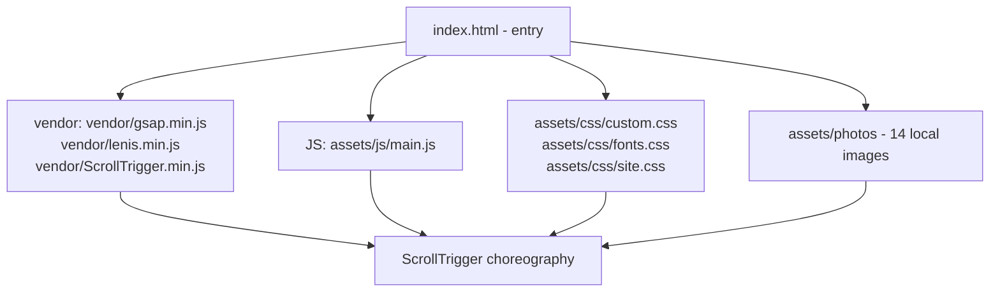
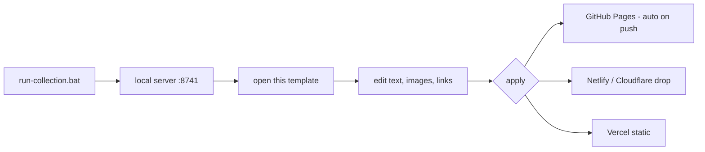

# Creative Software Agency — Creative Software Agency Portfolio Template

> Tactile agency site with a horizontal snap carousel, footprint-trail reveals and a goo-morphing accordion.

`creative` · `editorial` · `HTML/CSS/JS`

**Live:** https://sudiptasanki.github.io/PortfolioBuilder/creative/creative-agency/creative-software-agency/index.html

---

## How it works



## Run it locally



**Quick start (this repository):**

1. Double-click `run-collection.bat` (opens all 18) or `run-preview-hub.bat` (categorized hub).
   Both auto-start the local server at http://127.0.0.1:8741.
2. Open http://127.0.0.1:8741/creative/creative-agency/creative-software-agency/index.html

**Standalone (no repo):**

```bash
cd templates/static/html/creative/creative-agency/creative-software-agency
python -m http.server 8741
# open http://localhost:8741
```

Opening `index.html` directly from disk also works in most browsers — use the server if any asset looks blocked.

## Apply it

| Option | How |
|---|---|
| **This repo (auto)** | Keep the folder under `templates/static/html/...` — pushing to `main` deploys it to GitHub Pages automatically and the showcase picks it up on the next catalog compile |
| **Netlify / Cloudflare** | Drag-and-drop this folder onto their dashboards — zero build step |
| **Vercel** | Import the folder as a static project (framework preset: Other) |
| **Own GitHub repo** | Push the folder, enable Pages on the branch — same file layout works |

## Files

| Path | Purpose |
|---|---|
| `index.html` | Entry page — all markup |
| `assets/css/custom.css` | Styles |
| `assets/css/fonts.css` | Styles |
| `assets/css/site.css` | Styles |
| `assets/js/main.js` | Behaviour / animation |
| `vendor/gsap.min.js`, `vendor/lenis.min.js`, `vendor/ScrollTrigger.min.js` | Vendored libraries (no install needed) |
| `assets/photos/` | 14 local images |
| `assets/fonts/archivo-black-latin-400-normal-BTVu2TQR.woff2` | Static asset |
| `assets/fonts/archivo-black-latin-400-normal-HW9MwEcM.woff` | Static asset |
| `assets/fonts/bn-blacklettra-400-CD3rVxbt.woff2` | Static asset |
| `assets/fonts/geist-mono-latin-400-normal-B2yvC1Cq.woff` | Static asset |
| `assets/fonts/geist-mono-latin-400-normal-DTRLJnHl.woff2` | Static asset |
| `assets/fonts/geist-mono-latin-600-normal-bZn07FKM.woff` | Static asset |
| `template.json` | Catalog metadata (id, live URL, deployment shard) |

## Make it yours

1. Search `index.html` for the persona name and replace it (plus emails and social links).
2. Swap images in `assets/photos/` — keep the same filenames, or update the references.
3. Project entries live in the JS data block (search for `title:`) or directly in the HTML.

---

Credits: Three.js (MIT) and GSAP (GreenSock standard license) vendored where used · photography stored locally (Unsplash License) · part of the [Portfolio Builder](https://github.com/SudiptaSanki/PortfolioBuilder) open-source collection · MIT.
